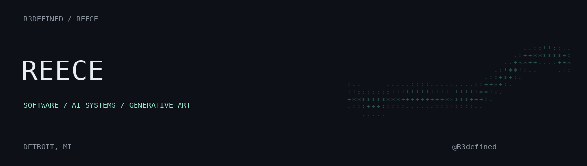

<picture>
  <source media="(prefers-reduced-motion: reduce)" srcset="assets/profile-static.png">
  
</picture>

I build software, AI workflows, and generative art. Based in Detroit.

I'm interested in how people use these systems, how they fail, and how to make them secure and worth maintaining.

### Selected work

| Project | What it is |
| :--- | :--- |
| [Transformation wall](https://github.com/R3defined/transformation-wall-web) | A black-and-gold Three.js recreation of Junkiyoshi's generative sketch. |
| [Citizens of AI starter](https://github.com/R3defined/citizens-of-ai-starter) | An Astro blog starter for a hands-on AI workshop. |
| [Personal portfolio](https://github.com/R3defined/reecehall-portfolio) | The code behind my personal website. |

### Exploring

- Data exploration and visualization
- Information security and secure systems
- Hardware and hands-on experimentation
- Scientific software, spatial AI, and open science

[Browse my repositories](https://github.com/R3defined?tab=repositories)
